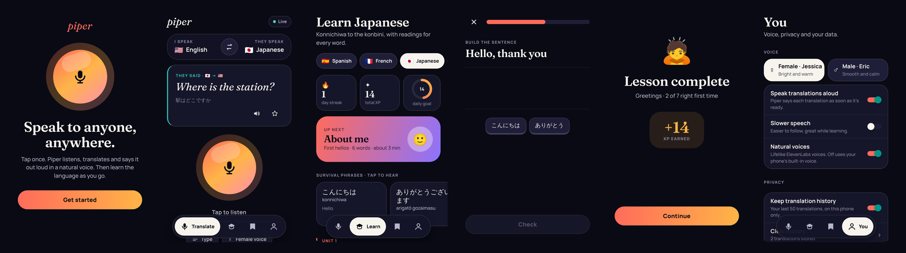

# Piper

**Speak to anyone, anywhere.** Tap once: Piper listens, works out which of two languages was spoken, translates it, and says it out loud in a natural female or male voice. Then it teaches you the language as you go.



## What's in this MVP

**Live translation**
- One big button. Tap to listen, tap again to translate. Either person can speak; Piper detects the language and translates the other way.
- Translations are spoken aloud with ElevenLabs voices (Jessica, female, or Eric, male), with the phone's built-in voice as an automatic fallback.
- Non-Latin scripts (Japanese, Korean, Chinese, Arabic, Hindi, Greek, Thai, Russian) come with a romanized reading.
- Type instead when it's loud. Replay or star any translation. 20 languages.

**Learning**
- Courses for Spanish (3 units, 9 lessons), French and Japanese, with Italian, German, Portuguese and Korean marked as coming soon.
- Five exercise types: choose the words, listen and pick, match pairs, build the sentence, and say it out loud (scored by speech recognition when live).
- Streaks, XP and a daily goal ring, survival phrases you can tap to hear, and a flip-card word deck for review.

**Design**: "sound as light". A night-ink canvas with an aurora of coral, saffron, lagoon and iris; Fraunces for display type and Manrope for body; a breathing, gradient orb that ripples with your voice. Dark-first, with WCAG AA contrast.

## Stack

- **Expo SDK 58** (React Native 0.88, TypeScript, Expo Router). One codebase for iPhone, Android and web.
- **Server**: Expo Router API routes in `src/app/api` keep the keys off the device.
  - `POST /api/listen`: audio → ElevenLabs Scribe (speech-to-text) → Claude (translation)
  - `POST /api/translate`: text → Claude
  - `POST /api/speak`: text → ElevenLabs voice (mp3)
  - `POST /api/transcribe`: audio → text, for pronunciation practice
  - `GET /api/health`: which providers are configured
- **Translation**: Claude (`claude-opus-5-5`, low effort for speed, structured JSON output, automatic fallback model on refusals).
- All app data lives on the device (AsyncStorage). No accounts, no database.

## Run it

```bash
npm install
cp .env.example .env     # add ANTHROPIC_API_KEY and ELEVENLABS_API_KEY
npx expo start           # press i / a / w for iOS, Android or web
```

Without keys, Piper runs in **Demo** mode: the button still listens, and plays sample exchanges from the phrasebook so the whole experience can be tried.

To test the full live pipeline without spending credits, use the bundled stand-in providers:

```bash
npm run mock    # fake Anthropic + ElevenLabs on :4010
ANTHROPIC_API_KEY=test ANTHROPIC_BASE_URL=http://localhost:4010 \
ELEVENLABS_API_KEY=test ELEVENLABS_BASE_URL=http://localhost:4010/v1 npx expo start --web
npm run e2e     # walks every screen in a phone-sized browser (needs Playwright)
```

Checks: `npm run typecheck` and `npm run lint`.

**Native builds** need a development build (not Expo Go) because of the microphone and audio modules: `npx eas-cli@latest build --profile development`. Deploy the API routes with EAS Hosting (`npx eas-cli@latest deploy`) and set `EXPO_PUBLIC_API_URL` to that URL for store builds.

## US compliance built in

| Area | What Piper does |
| --- | --- |
| **COPPA** (children under 13) | Neutral age screen ("What year were you born?") before anything else. Anyone who could be under 13 is blocked, and the block survives "Erase my data" and app restarts. Not directed to children. |
| **Recording consent** (two-party / all-party states such as CA, FL, IL, MD, MA, MT, NH, PA, WA) | Onboarding requires the user to agree to tell people before recording, with an explanation. The mic is only on while the glowing Listening state shows, capped at 30 seconds. |
| **Biometric privacy** (Illinois BIPA, Texas, Washington) | No voiceprints or speaker identification. Audio is used only to transcribe, held in memory for the request, never stored or logged. ElevenLabs calls use `enable_logging=false` (zero retention where the plan supports it). |
| **State privacy laws** (CCPA/CPRA, Virginia, Colorado, Connecticut, Texas, Oregon and others) | Plain-language Privacy Policy in the app, no sale or sharing, no ads or tracking, a "Your privacy choices" entry, and one-tap **Erase my data**. History can be switched off. |
| **Consent records** | Terms and Privacy acceptance is stored with a policy version; changing `POLICY_VERSION` makes everyone agree again. |
| **ADA / WCAG 2.1 AA** | Screen-reader labels, roles and states on every control, live regions for status and results, 48pt touch targets, AA contrast, Dynamic Type support with sensible caps. |
| **Safety** | Terms and the You tab warn that translations can be wrong and point to 911 / 112 in emergencies. |
| **App Store / Play** | Microphone purpose strings, iOS privacy manifest (audio and user content, not linked, no tracking), location and contacts permissions explicitly blocked on Android. |

### Before you ship

- **Have a lawyer review** `src/lib/legal.ts` (Privacy Policy and Terms). It's written to match what the code does, but it's not legal advice.
- Replace the placeholder contact `privacy@piper.app` and add your company name and address.
- Sign data processing terms with Anthropic and ElevenLabs, and confirm ElevenLabs zero-retention is enabled on your plan.
- Fill in the App Store privacy "nutrition label" and Play Data safety form to match the table above.
- Replace the in-memory rate limiter in `src/server/http.ts` with a shared store (e.g. Redis) once you run more than one server instance.

## Project layout

```
src/app/(tabs)/     Translate, Learn, Phrases, You
src/app/lesson/     Lesson player
src/app/welcome.tsx Onboarding: age check, setup, consent
src/app/legal/      Privacy Policy and Terms
src/app/api/        Server routes (keys live here only)
src/server/         Claude + ElevenLabs clients
src/content/        Courses and the exercise generator
src/components/     Orb, aurora, cards, tab bar and other UI
src/lib/            Store, API client, voice output, live interpreter hook
src/theme/          Design tokens
```
